# Roster Caller

**Cold-call students fairly, keep attendance, and learn names, all from your iPhone.**

Roster Caller picks a student at random and shows their photo and name, then you tap **Answered**, **No answer**, or **Absent**. Over the semester it balances who gets called, so students who have been called least come up first. You can export the records as CSV at any time. A separate **Learn** mode helps you learn students' names from their photos.

You set it up by importing the class photo roster PDF from MyPack Portal. **Student information never leaves your phone.** The PDF is read on the phone itself, and nothing is uploaded.

<p align="center">
  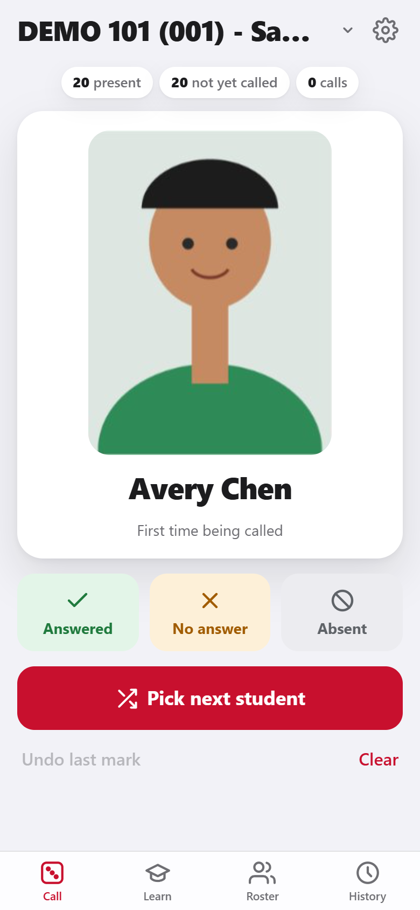
  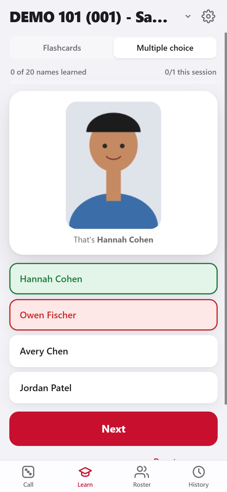
  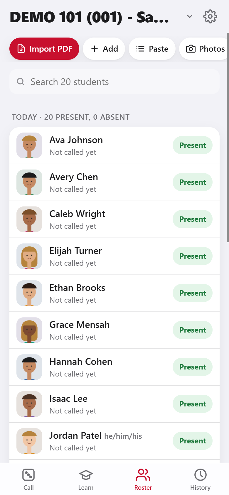
</p>

<sub>All screenshots use a fictional sample class with cartoon avatars. No real students are shown.</sub>

**Open the app:** <https://tnaziz.github.io/RosterCaller/>

---

## Contents

1. [What it does](#what-it-does)
2. [Privacy](#privacy)
3. [Set up (once per phone)](#1-set-up-once-per-phone)
4. [Get your photo roster from MyPack Portal](#2-get-your-photo-roster-from-mypack-portal)
5. [Import the roster](#3-import-the-roster)
6. [Call on students](#4-call-on-students)
7. [Learn names](#5-learn-names)
8. [Attendance and the roster](#6-attendance-and-the-roster)
9. [History and CSV export](#7-history-and-csv-export)
10. [Settings, backups and a new semester](#8-settings-backups-and-a-new-semester)
11. [Troubleshooting](#troubleshooting)
12. [Sharing with colleagues](#sharing-with-colleagues)
13. [Maintaining the app](#maintaining-the-app)

---

## What it does

| | |
|---|---|
| **Random, fair calling** | Picks a present student at random, favoring those called least. Calls are balanced across the whole semester, not per day. |
| **One-tap records** | Mark each call **Answered**, **No answer**, or **Absent**. Every mark is saved with the date and time. |
| **Photo roster import** | Reads the MyPack Portal *Faculty Class Photo Roster* PDF, including photos, names, student IDs, pronouns, and FERPA flags. |
| **Attendance** | Mark students absent for the day so they aren't picked. |
| **Name practice** | Flashcards and multiple choice. The names you miss come back more often. |
| **CSV export** | Call log, per-student summary, and attendance by date, with student IDs for your gradebook. |
| **Several classes** | Keep each section separate and switch with the class menu at the top. |
| **Works offline** | Once installed, it works without a connection. |

## Privacy

- Rosters, photos, IDs, and records are stored **only on your phone**, in the app's own storage. They are never sent to GitHub or anywhere else.
- The roster PDF is read on the phone with [pdf.js](https://mozilla.github.io/pdf.js/). It is bundled with the app, so nothing is loaded from other sites.
- Information leaves the phone only when you send it yourself, such as a CSV export or backup file you email or save to iCloud Drive. Students' photos are part of their educational records, so treat exports, backups, and the roster PDF with the same care.
- Students marked `*` on the roster have additional FERPA restrictions. The app shows a **FERPA** tag next to their name as a reminder.

---

## 1. Set up (once per phone)

You need an iPhone or iPad with iOS 16.4 or later.

1. On your iPhone, open **Safari** and go to **<https://tnaziz.github.io/RosterCaller/>**.
2. Tap the **Share** button (the square with an arrow), then **Add to Home Screen**, then **Add**.
3. From now on, open **Roster Caller** from its Home Screen icon. It opens full-screen like an app, works offline, and iOS keeps its data more reliably than in a Safari tab.

<p align="center">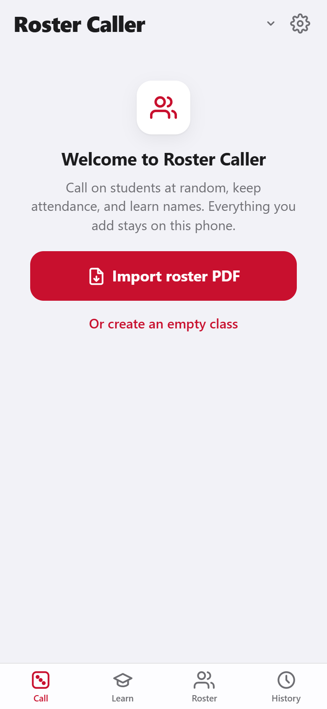</p>

> **Want to try it before using a real class?** Use the sample roster: on your iPhone, open
> <https://tnaziz.github.io/RosterCaller/samples/Sample_Roster.pdf>, tap **Share → Save to Files**, and import it as in step 3. It has 20 fictional students. Delete the class afterwards in **Settings → Delete this class**.

## 2. Get your photo roster from MyPack Portal

The app reads the **Faculty Class Photo Roster** PDF that you download from the **Faculty** page in **MyPack Portal**.

1. Sign in to **MyPack Portal** and open the **Faculty** page.
2. Choose the term and class, and open the class's **photo roster**.
3. Download or save it as a **PDF**. The first page is headed *Faculty Class Photo Roster* and shows the class, term, and *Roster Count*.
4. Put the PDF on your iPhone in **Files**. Either:
   - download it on the iPhone itself (in Safari, tap **Share → Save to Files**), or
   - download it on your computer and **AirDrop** it to the iPhone, then choose **Save to Files**.

   Saving it under **On My iPhone** rather than **iCloud Drive** keeps it off the cloud.

> Use the PDF exactly as downloaded. A scan, a photo, or a screenshot of the roster will not import.

## 3. Import the roster

1. Open Roster Caller and tap **Import roster PDF**, or **Import PDF** on the **Roster** tab.
2. Pick the PDF in Files. The app reads it on the phone, which takes a few seconds.
3. Check the preview. It shows how many students were found, how many have photos and pronouns, and every face with its name.
4. Under **Import into**, choose **New class**. The class name is filled in from the roster, and you can edit it. To refresh a class you already have, choose **Update "…"** instead.
5. Tap **Import**.

<table align="center"><tr>
<td align="center">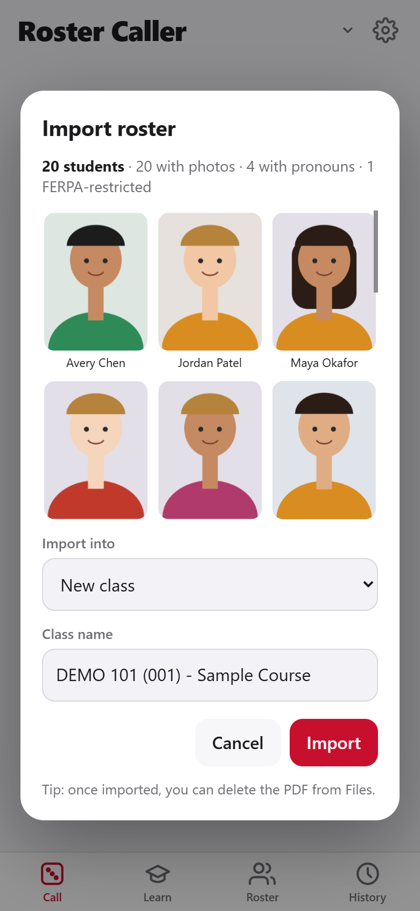<br><sub>Check the count and faces, then <b>Import</b></sub></td>
<td align="center">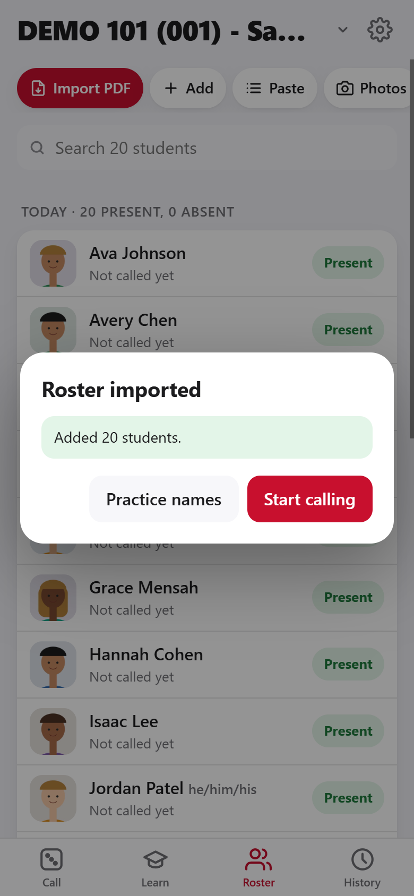<br><sub>Done. Start calling or practice names</sub></td>
</tr></table>

**Good to know**

- If the number of students found doesn't match the *Roster Count* on the PDF, the app warns you. This usually means pages are missing from the PDF.
- **Re-importing is safe.** When students add or drop the class, download a new roster and import it into the same class with **Update "…"**. Students are matched by student ID and then by name. Their call history is kept, new students are added, and names, pronouns, and photos are refreshed. Students no longer on the roster are kept, and the app tells you how many, so you can delete them yourself if they dropped.
- Once imported, you can delete the PDF from Files.

## 4. Call on students

1. Go to the **Call** tab and tap **Pick a student**.
2. Faces slide past and stop on one student, whose name and pronouns appear.
3. Tap **Answered**, **No answer**, or **Absent**. The mark is saved with today's date.
4. Tap **Pick next student** to continue.

<table align="center"><tr>
<td align="center">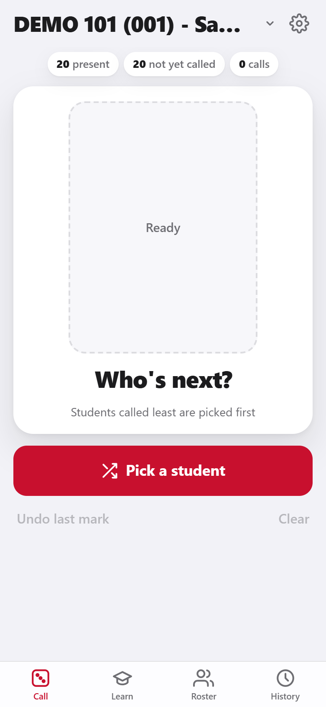<br><sub>1. Tap <b>Pick a student</b></sub></td>
<td align="center">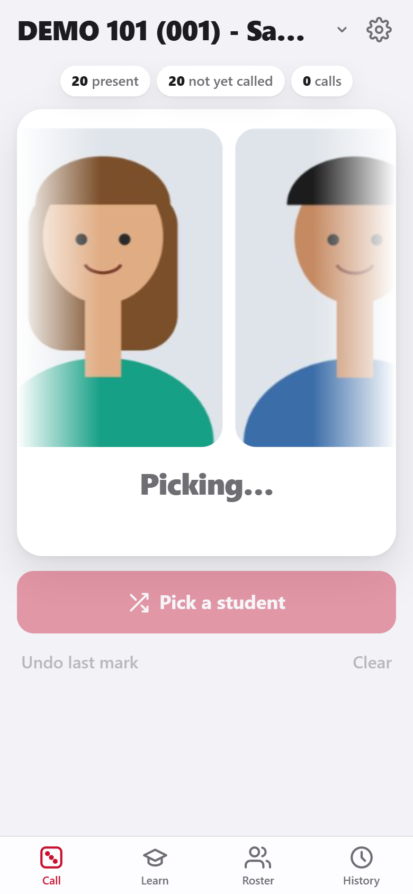<br><sub>2. Faces slide past…</sub></td>
<td align="center"><br><sub>3. …and stop on a student</sub></td>
<td align="center">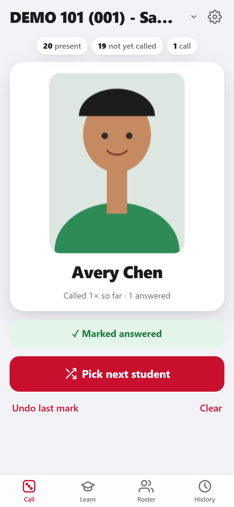<br><sub>4. The mark is saved</sub></td>
</tr></table>

**How picking works**

- **Balanced over the semester.** Students with the fewest calls are picked first, counting every class day. Everyone gets called once before anyone is called a second time, and so on. The count never resets by itself; see [a new semester](#8-settings-backups-and-a-new-semester).
- The chips at the top show who's present, how many students haven't been called yet, and the total number of calls.
- **Absent** students are skipped for the rest of the day. Marking a picked student **Absent** also marks them absent for today.
- Made a mistake? Tap **Undo last mark**, or delete any mark later in **History**.
- For pure random picking, turn off **Call least-called first** in Settings. To skip the animation, turn off **Pick animation**. It is also skipped when the iPhone's *Reduce Motion* setting is on.

## 5. Learn names

The **Learn** tab is for practice only. It never changes call records or attendance.

- **Flashcards:** look at the face, tap to reveal the name, then tap **Knew it** or **Missed it**.
- **Multiple choice:** pick the right name out of four.

Names you miss come back sooner. A name counts as learned after you get it right three times in a row, and the bar at the top shows your progress. **Reset progress** starts over.

<table align="center"><tr>
<td align="center">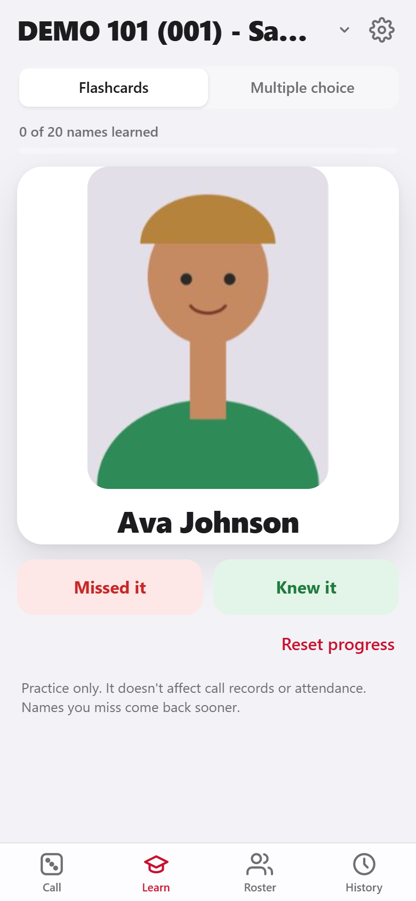<br><sub>Flashcards</sub></td>
<td align="center"><br><sub>Multiple choice: the correct name turns green</sub></td>
</tr></table>

## 6. Attendance and the roster

On the **Roster** tab:

- Tap **Present / Absent** next to a name to set today's attendance. Absent students are never picked.
- **Search** by name or student ID.
- Tap a student to change their photo, name, pronouns, or ID, see their totals, or delete them.
- Other ways to add students: **Add** one at a time (with a photo from the camera), **Paste** a list of names (one per line; "Last, First" is converted), or **Photos** to import image files named after students (`Jane Doe.jpg`).

<p align="center"></p>

## 7. History and CSV export

The **History** tab shows each day's marks. Choose a date at the top. Tap **×** to delete a mistaken mark.

Tap **Export CSV** and choose a file. The iPhone share sheet opens, so you can **Save to Files**, email it to yourself, or AirDrop it to your computer. The files open in Excel and Google Sheets.

| File | Contents |
|---|---|
| **Call log** | One row per mark: date, time, student ID, student, result |
| **Student summary** | One row per student: student ID, times called, answered, no answer, absences, % answered |
| **Attendance by date** | One row per student and one column per day with records: *Present* or *Absent* |

<table align="center"><tr>
<td align="center">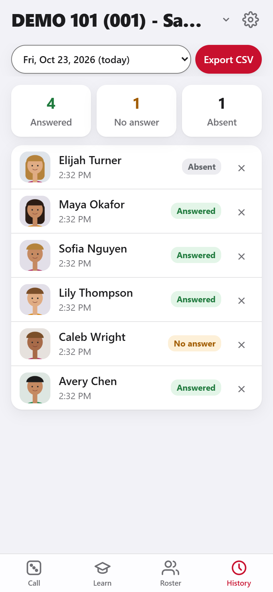<br><sub>A day's marks</sub></td>
<td align="center">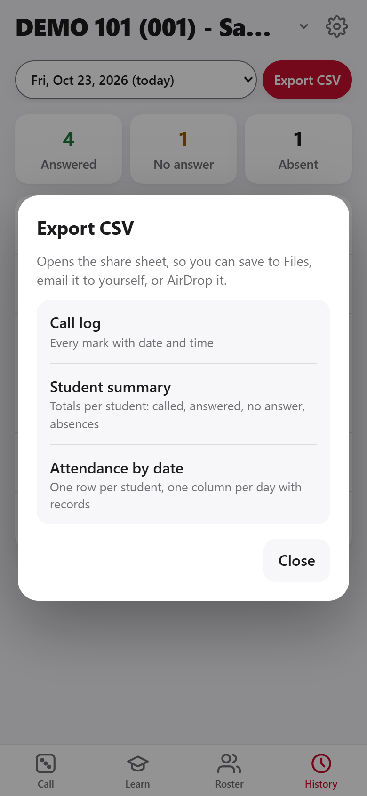<br><sub>Choose what to export</sub></td>
</tr></table>

## 8. Settings, backups and a new semester

Tap the **gear** at the top right.

<p align="center">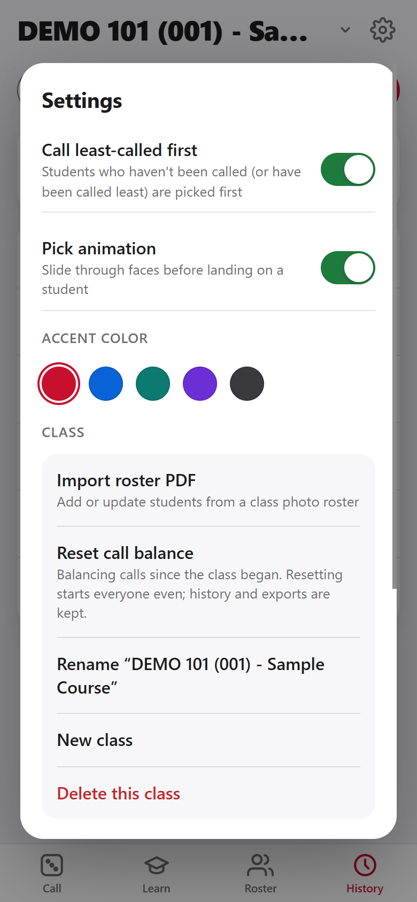</p>

- **Call least-called first / Pick animation:** described in [Call on students](#4-call-on-students).
- **Accent color:** red, blue, teal, purple, or graphite.
- **Reset call balance:** starts everyone even, so picks come from the whole class again. History and exports keep every record. Use it at the start of a new semester, or whenever you want a fresh rotation.
- **Classes:** import a roster, rename, add, or delete a class. Switch classes with the menu at the top of the screen.
- **Back up all data:** saves one file with every class, photo, and record, through the share sheet. **Restore from backup** loads it on a new or reset phone.

> **Back up now and then.** Deleting the app from the Home Screen deletes its data, and the data doesn't sync between devices. A backup is the only way to move it to a new phone. Backups contain student photos, so keep them somewhere private.

**Starting a new semester:** import the new roster as a **New class** (recommended, which keeps each semester separate), or delete the old class when you no longer need its records.

---

## Troubleshooting

| Problem | What to do |
|---|---|
| "Couldn't read that PDF" or "No students found" | Use the PDF exactly as downloaded from MyPack Portal, not a scan, a photo, or a printed-to-image copy. |
| Fewer students than the *Roster Count* | Pages are probably missing from the PDF. Download the full roster and import it again with **Update "…"**. |
| A photo or name looks wrong | Tap the student on the **Roster** tab to fix it. |
| The app doesn't show a new feature | Open it once while online, close it, and open it again. |
| My classes are gone | iOS may have cleared the app's storage, or the app was removed from the Home Screen. **Restore from backup** in Settings. |
| I want it on my iPad too | Install it there the same way, then use **Back up** on one device and **Restore** on the other. |

## Sharing with colleagues

Send them the link <https://tnaziz.github.io/RosterCaller/> and this page. Each person's classes and records stay on their own phone, so nobody can see anyone else's data and no accounts are needed.

The PDF import is designed for NC State's *Faculty Class Photo Roster*. Rosters from other systems may not import cleanly, but **Paste** and **Photos** work anywhere.

To run your own copy, fork this repository and turn on **Settings → Pages → Deploy from a branch → `main` / (root)**.

## Maintaining the app

Plain HTML, CSS, and JavaScript with no build step.

| File | Purpose |
|---|---|
| `index.html` | The whole app: UI, storage (IndexedDB), and logic |
| `roster-pdf.js` | Reads the roster PDF: pairs each photo with the ID and name printed under it |
| `vendor/pdfjs/` | pdf.js 4.10.38 (legacy build), © Mozilla, Apache License 2.0 |
| `sw.js` | Offline cache. **Bump `VERSION` whenever any file changes**, so installed copies update |
| `samples/` | The fictional sample roster (`Sample_Roster.pdf`) and its source |
| `docs/` | README screenshots and the scripts that make them |

`.gitignore` blocks PDFs, CSVs, and backup files, apart from the sample roster, so real student data can't be committed by accident.

**Regenerate the sample roster** (needs Python with Pillow, and Chrome):

```bash
python docs/tools/make_sample_roster.py
chrome --headless=new --no-pdf-header-footer --print-to-pdf=samples/Sample_Roster.pdf samples/sample_roster.html
```

**Retake the screenshots** (needs Node 20+ and Chrome). Run each in its own terminal from the repository folder:

```bash
python -m http.server 5173 --bind 127.0.0.1
```

```bash
chrome --headless=new --remote-debugging-port=9222 --user-data-dir=/tmp/rc-shots about:blank
```

```bash
node --experimental-websocket docs/tools/screenshots.mjs
```
